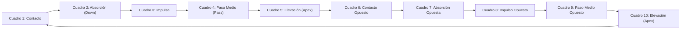
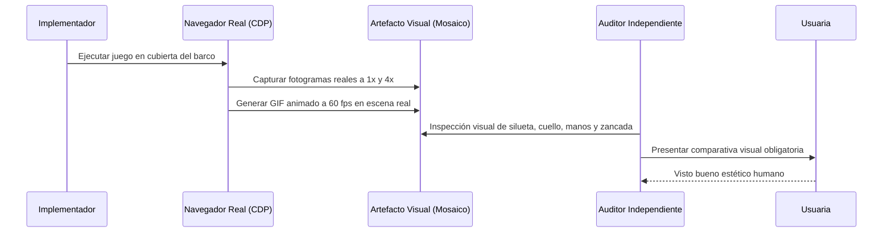

# Plan Maestro: Kratos en Pixel Art 16-bit Profesional y Verificación Visual Real

> **Propósito:** Definir con rigor de desarrollo de videojuegos profesional el reemplazo definitivo de los modelos matemáticos deformes por un pipeline de pixel art animado con masa anatómica constante, zancada biomecánica real y un protocolo de auditoría visual estricto que erradique las revisiones ciegas por números.

---

## 1. El Porqué: Diagnóstico Honesto del Fracaso Previo

Hasta este momento se cayó en dos trampas conceptuales:

| Enfoque Utilizado | Qué se intentó | Por qué fracasó |
| :--- | :--- | :--- |
| **Generador de imágenes por IA (Difusión)** | Pedirle a una IA que ilustrara a Kratos fotograma a fotograma. | La IA dibuja imágenes fijas, pero **no tiene concepto de tiempo ni biomecánica**. Clonó la misma pose estática en todos los cuadros y Kratos se deslizaba congelado como una estatua sobre ruedas. |
| **Generador procedural por fórmulas (Python/Trigonometría)** | Calcular el cuerpo humano con `math.sin`, líneas vectoriales y coordenadas poligonales. | La matemática de líneas y cajas **no sabe de anatomía humana ni volumen muscular**. O genera bloques gigantescos (el Kratos jorobado con cabeza incrustada en el hombro) o genera figuras de alambre (la mantis religiosa/araña). |
| **La trampa de la "Auditoría Numérica Ciega"** | Medir `ImageChops.difference`, `bbox[3] == 59`, tamaño de archivo y exit codes. | **Los números dieron `True` pero la imagen era una aberración visual.** Los scripts certificaban que "se movían 1.200 píxeles", pero esos píxeles eran un monstruo amorfo. Medir deltas no sustituye mirar el dibujo. |

**Conclusión:** En los juegos profesionales de 16 bits (*Metal Slug*, *Castlevania: SotN*, *God of War: Betrayal*), los sprites jamás se calcularon con trigonometría ni se generaron con fotos aleatorias. Se construían con **diseño de píxeles estructurado por grupos de masa muscular** y animación cuadro a cuadro donde cada pieza conserva su volumen.

---

## 2. El Qué: Qué se va a Construir Exactamente

Se construirá el conjunto completo de spritesheets de Kratos en **pixel art 16-bit auténtico** respetando la resolución interna de $480 \times 270$:

1. **Escala y Lienzo:**
   - Lienzo por cuadro: **$97 \times 59\text{ px}$** (mantiene 100% la compatibilidad con el motor actual, físicas y cámaras).
   - Altura útil de Kratos: **$53 - 54\text{ px}$** (exactamente 1/5 de la pantalla lógica, escala heroica clásica).
2. **Anatomía Humana Espartana Reconocible:**
   - **Cabeza y Cuello:** Cuello visible de 2-3 px que separa la cabeza de los hombros (se acabó el Kratos decapitado/jorobado). Cráneo calvo con brillo ceniciento, ceño fruncido bajo sombra, nariz griega aguileña en 3/4, perilla en cuña cerrada bajo el mentón y arco del tatuaje de Ares continuo desde la coronilla hasta el torso.
   - **Torso y Hombros:** Espalda en V con deltoides anchos pero orgánicos (no rampas de hormigón), pectorales definidos con surco esternal, pared abdominal con six-pack visible y banda roja diagonal.
   - **Brazos y Cuchillas del Caos:** Brazos musculosos de grosor proporcionado (4 px), antebrazos con cadenas de hierro enrolladas y **manos con puños reales empuñando las empuñaduras**, no machetes soldados a muñones cúbicos.
   - **Cintura y Faldón:** Faldón de cuero espartano con *pteruges* (tiras colgantes) que reaccionan con inercia y faja carmesí central.
   - **Piernas y Pies:** Muslos atléticos, rodilleras de bronce, grebas moldeadas a la pantorrilla y sandalias con ataduras visibles apoyadas en el suelo ($y=58$).

---

## 3. El Cómo: Arquitectura de Animación Profesional

Se rompe la limitación arbitraria de "6 cuadros". Cada acción tendrá los cuadros que su física biomecánica exige:

### 3.1. Ciclo de Carrera (*Run Cycle* — 8 a 10 Cuadros)
Para que el personaje no se deslice ni se vea tieso:
- **Cuadro 1 — Contacto Derecho:** Talón delantero toca el suelo, torso inclinado $10^\circ$ hacia el frente, pierna trasera extendida en empuje.
- **Cuadro 2 — Caída de peso (*Squash / Down*):** La rodilla delantera amortigua el impacto, el centro de masa desciende 2 px ($y=56$), la cabeza baja con ferocidad y el faldón se comprime.
- **Cuadro 3 — Impulso (*Push*):** La pierna delantera empuja con fuerza, el torso empieza a subir.
- **Cuadro 4 — Paso Medio (*Passing Position*):** La pierna contraria cruza por el centro flexionada con la rodilla alta; el pie de apoyo está en el suelo.
- **Cuadro 5 — Elevación / Vuelo (*Up / Apex*):** Ambos pies están en el aire por 1 fotograma, el torso alcanza su punto más alto ($y=53$) y las cadenas de las Cuchillas se retrasan por inercia hacia atrás.
- **Cuadros 6 a 10:** Espejo simétrico y biomecánico con la pierna izquierda adelantada.

### 3.2. Reposo con Respiración Viva (*Idle* — 4 Cuadros)
- Se eliminan los 2 cuadros tiesos. Ciclo suave de 4 cuadros donde el pecho se expande 1 px hacia arriba y adelante, los deltoides respiran y las cadenas oscilan suavemente.

### 3.3. Ataques y Combate (Combos Ligeros, Plume, Ascension)
- **Anticipación clara:** El brazo y el torso retroceden antes de lanzar el tajo (principio básico de animación).
- **Extensión activa:** El golpe se proyecta con el fuego de las Cuchillas del Caos.
- **Recuperación física:** El tirón de las cadenas para regresar a la guardia.

### 3.4. Rodada de Evasión (*Roll* — 5 Cuadros)
- Anticipación en agachado $\to$ apoyo de hombro en suelo $\to$ giro en bola compacta $\to$ patada de salida $\to$ recuperación con apoyo de manos y pies en $y=58$.

---

## 4. El Resultado Esperado

1. **Lectura Inmediata:** Al abrir el juego, se reconoce a Kratos al instante: un guerrero espartano musculoso, atlético, enfadado, con cuello, cabeza proporcionada y armas empuñadas.
2. **Fluidez y Peso a 60 Hz:** Al mover a Kratos con las teclas, el personaje corre con zancadas amplias, rebota verticalmente con peso físico y sus cadenas tienen inercia real. Cero deslizamientos de estatua y cero movimientos de robot de chatarra.
3. **Integración Total:**
   - Compatibilidad 100% con las físicas de salto, doble salto, plataformas y rodada.
   - Puntos de anclaje de cadenas de `WeaponLayer.ts` sincronizados exactamente con las manos de Kratos.
   - Batería de 28 casos en Chrome CDP aprobada con 0 errores.

---

## 5. El Nuevo Protocolo de Revisión Visual Real (Fin de las Métricas Ciegas)

Para asegurar que **nunca más se apruebe una aberración visual con números vacíos**, se establece la siguiente compuerta obligatoria:

### Reglas de la Verificación Real:
1. **Prohibido aprobar por deltas o números:** No se emitirá ningún dictamen basado únicamente en `ImageChops.difference`, conteos de colores o códigos de salida.
2. **Captura Obligatoria en el Contexto del Juego:** Cada revisión debe incluir:
   - Captura de Kratos parado en la cubierta del barco a escala 4x (para validar rostro, cuello y manos).
   - Tira de película (*filmstrip*) con los 8-10 fotogramas de carrera alineados uno al lado del otro.
   - GIF animado a 60 fps grabado directamente del canvas del juego corriendo.
3. **Lista de Verificación de Anatomía Visual (Humana):**
   - [ ] ¿Hay cuello visible conectando la cabeza con el torso? (Sí / No)
   - [ ] ¿Las manos empuñan las armas en lugar de tener hojas flotantes o muñones? (Sí / No)
   - [ ] ¿Los hombros tienen forma trapezoidal humana en vez de rampa cúbica? (Sí / No)
   - [ ] ¿En la carrera se observa rebote vertical (subida y bajada del torso)? (Sí / No)
   - [ ] ¿Las piernas se abren en una zancada atlética completa? (Sí / No)
   Si cualquiera de estas preguntas es "No", la tarea se declara **RECHAZADA AUTOMÁTICAMENTE**, sin importar qué digan los tests de código.
