# Referencia de juego: God of War: Betrayal

Este tablero reúne referencias visuales y descripciones publicadas para orientar la sensación de juego de la adaptación: ritmo y lectura de acción lateral inspirados por *God of War: Betrayal*, con la historia del primer *God of War* de PS2. **Es material de referencia externo, no evidencia del juego de este repositorio.** Para que se vean sin conexión, se guardaron copias locales en `docs/referencias/imagenes/`; no son assets licenciados para el juego ni material creado por el proyecto. Se conserva la atribución a las fuentes originales.

## Referencias visuales

Este tablero contiene **18 archivos locales** en total: los tres originales más quince capturas añadidas en `REF-BETRAYAL-02`. Cada miniatura enlaza un archivo local; la atribución y la URL directa de origen aparecen en la misma fila. Son referencias externas, no evidencia del juego de este repositorio ni assets licenciados para integrarse al juego.

| Captura local | Observación visual y atribución | Formato, dimensiones y tamaño |
| --- | --- | --- |
| 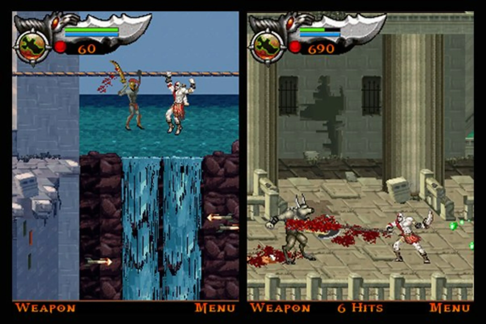 | Dos momentos verticales independientes, no un nivel panorámico. Fuente: [Backloggd/IGDB](https://backloggd.com/games/god-of-war-betrayal/) · [archivo original](https://images.igdb.com/igdb/image/upload/t_1080p_2x/gbttvmgooigzhoria1sx.webp). | WebP · 3240×2160 · 255,346 bytes |
| 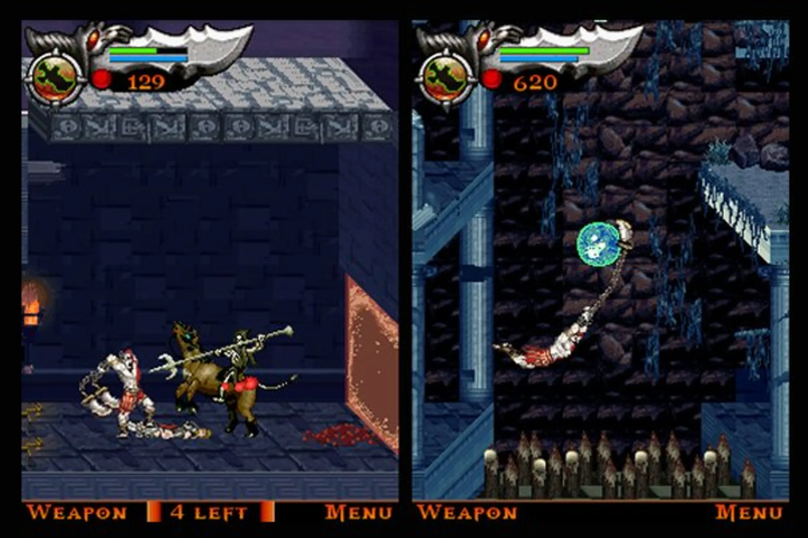 | Combate y desplazamiento encadenado en dos escenas verticales. Fuente: [Backloggd/IGDB](https://backloggd.com/games/god-of-war-betrayal/) · [archivo original](https://images.igdb.com/igdb/image/upload/t_1080p_2x/j1hxz0q7xvntoesxcqag.webp). | WebP · 3240×2160 · 236,910 bytes |
| 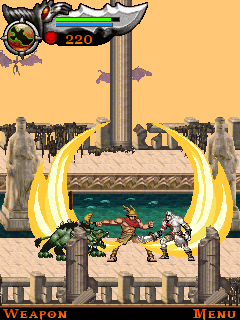 | Una pelea con interfaz y efecto amplio; no establece por sí sola alcance o daño. Fuente: [Pocket Gamer](https://www.pocketgamer.com/god-of-war-betrayal/hands-on-with-god-of-war-betrayal-on-mobile-plus-first-21-screens/) · [archivo original](https://media.pocketgamer.com/artwork/na-chpj/lvl_10_-_final_fight.jpg). | JPEG · 240×320 · 149,168 bytes |
| 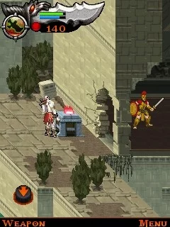 | Cofre, enemigo y recorrido lateral. Fuente: [MobyGames 421181](https://www.mobygames.com/game/45251/god-of-war-betrayal/screenshots/j2me/421181/) · [archivo VGTimes](https://files.vgtimes.com/gallery/main/177070/421181-god-of-war-betrayal-j2me.webp). | WebP · 240×320 · 21,992 bytes |
| 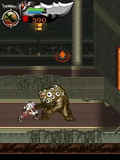 | Señal de acción sobre un encuentro con monstruo. Fuente: [MobyGames 421182](https://www.mobygames.com/game/45251/god-of-war-betrayal/screenshots/j2me/421182/) · [archivo VGTimes](https://files.vgtimes.com/gallery/main/177070/421182-god-of-war-betrayal-j2me.webp). | WebP · 240×320 · 16,716 bytes |
| 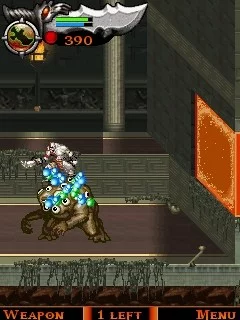 | Acción de remate visualmente distinta de la pose previa del monstruo. Fuente: [MobyGames 421183](https://www.mobygames.com/game/45251/god-of-war-betrayal/screenshots/j2me/421183/) · [archivo VGTimes](https://files.vgtimes.com/gallery/main/177070/421183-god-of-war-betrayal-j2me.webp). | WebP · 240×320 · 18,634 bytes |
| 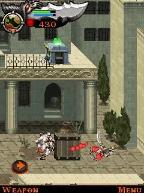 | Enemigo, caja y plataformas delimitan el espacio. Fuente: [MobyGames 421184](https://www.mobygames.com/game/45251/god-of-war-betrayal/screenshots/j2me/421184/) · [archivo VGTimes](https://files.vgtimes.com/gallery/main/177070/421184-god-of-war-betrayal-j2me.webp). | WebP · 240×320 · 22,494 bytes |
| 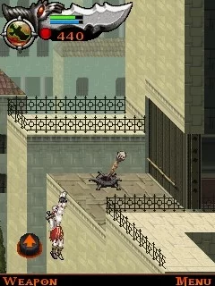 | Posición de agarre y salto entre niveles verticales. Fuente: [MobyGames 421185](https://www.mobygames.com/game/45251/god-of-war-betrayal/screenshots/j2me/421185/) · [archivo VGTimes](https://files.vgtimes.com/gallery/main/177070/421185-god-of-war-betrayal-j2me.webp). | WebP · 240×320 · 22,896 bytes |
| 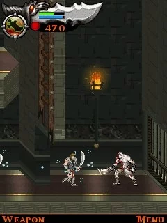 | Efecto azul claro separa el impacto de las siluetas. Fuente: [MobyGames 421186](https://www.mobygames.com/game/45251/god-of-war-betrayal/screenshots/j2me/421186/) · [archivo VGTimes](https://files.vgtimes.com/gallery/main/177070/421186-god-of-war-betrayal-j2me.webp). | WebP · 240×320 · 13,644 bytes |
| 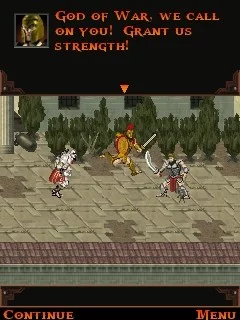 | Texto de introducción sobre una escena; se incluye como pantalla del juego, no como gameplay. Fuente: [MobyGames 421187](https://www.mobygames.com/game/45251/god-of-war-betrayal/screenshots/j2me/421187/) · [archivo VGTimes](https://files.vgtimes.com/gallery/main/177070/421187-god-of-war-betrayal-j2me.webp). | WebP · 240×320 · 19,082 bytes |
| 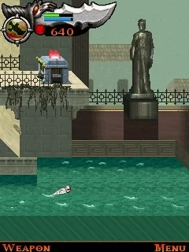 | Travesía acuática y escala vertical del escenario. Fuente: [MobyGames 421188](https://www.mobygames.com/game/45251/god-of-war-betrayal/screenshots/j2me/421188/) · [archivo VGTimes](https://files.vgtimes.com/gallery/main/177070/421188-god-of-war-betrayal-j2me.webp). | WebP · 240×320 · 18,250 bytes |
| 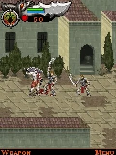 | Grupo de enemigos con lectura de combate en arena. Fuente: [MobyGames 421190](https://www.mobygames.com/game/45251/god-of-war-betrayal/screenshots/j2me/421190/) · [archivo VGTimes](https://files.vgtimes.com/gallery/main/177070/421190-god-of-war-betrayal-j2me.webp). | WebP · 240×320 · 22,760 bytes |
| 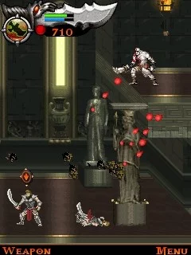 | Efectos rojos y posiciones verticales de enemigos. Fuente: [MobyGames 421191](https://www.mobygames.com/game/45251/god-of-war-betrayal/screenshots/j2me/421191/) · [archivo VGTimes](https://files.vgtimes.com/gallery/main/177070/421191-god-of-war-betrayal-j2me.webp). | WebP · 240×320 · 15,618 bytes |
| 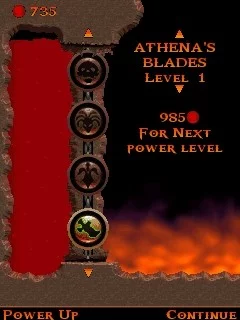 | Menú de mejora y selección de armas; no es una captura de combate. Fuente: [MobyGames 421192](https://www.mobygames.com/game/45251/god-of-war-betrayal/screenshots/j2me/421192/) · [archivo VGTimes](https://files.vgtimes.com/gallery/main/177070/421192-god-of-war-betrayal-j2me.webp). | WebP · 240×320 · 13,714 bytes |
| 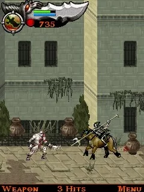 | Enemigo montado diferenciado de los soldados a pie. Fuente: [MobyGames 421193](https://www.mobygames.com/game/45251/god-of-war-betrayal/screenshots/j2me/421193/) · [archivo VGTimes](https://files.vgtimes.com/gallery/main/177070/421193-god-of-war-betrayal-j2me.webp). | WebP · 240×320 · 21,390 bytes |
| 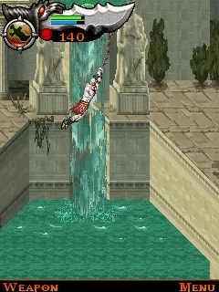 | Desplazamiento vertical con látigo y agua. Fuente: [MobyGames 421195](https://www.mobygames.com/game/45251/god-of-war-betrayal/screenshots/j2me/421195/) · [archivo VGTimes](https://files.vgtimes.com/gallery/main/177070/421195-god-of-war-betrayal-j2me.webp). | WebP · 240×320 · 22,668 bytes |
| 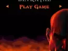 | Pantalla de título/menú distinta; no se presenta como gameplay. Fuente y archivo directo: [3DJuegos](https://i.3djuegos.com/juegos/8623/god_of_war_betrayal/fotos/set/god_of_war_betrayal-1958154.webp). | WebP · 140×105 · 1,526 bytes |
| 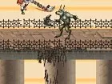 | Escena lateral de plataforma sobre agua, distinta de los compuestos existentes. Fuente y archivo directo: [3DJuegos](https://i.3djuegos.com/juegos/8623/god_of_war_betrayal/fotos/set/god_of_war_betrayal-1958156.webp). | WebP · 140×105 · 4,064 bytes |

Los archivos conservan sus formatos originales. La prueba por SHA-256 no encontró duplicados exactos entre las imágenes seleccionadas. La inspección visual omitió una captura con espera de descarga, otra casi idéntica a una escena de combate ya representada y dos miniaturas 3DJuegos que repetían paneles presentes en los compuestos o la captura de ataque existente. La pantalla de título 3DJuegos sí se conserva porque es distinta, pero queda etiquetada como menú y no como gameplay.

## Qué respaldan las fuentes

| Tipo de fuente | Observación o afirmación | Alcance y límite |
| --- | --- | --- |
| Capturas inspeccionadas | Los dos compuestos muestran, cada uno, dos momentos de juego verticales; aparecen combate, travesía y peligros de plataforma. La captura de Pocket Gamer muestra HUD, enemigos y un arco de ataque amplio. | Observación visual de imágenes concretas. No demuestra controles, reglas, animación completa ni duración. |
| Descripción periodística publicada | Pocket Gamer describe cinco niveles divididos en subniveles breves, ataques que encadenan combos, una secuencia de remate tras infligir suficiente daño, salto y doble salto, puzles simples de plataforma y empujar/halar estatuas. La reseña menciona saltar huecos, mover cajas, palancas y cofres, combos acrobáticos por pulsaciones repetidas, enemigos que quedan aturdidos antes de un remate QTE, dos hojas encadenadas, una espada amplia y variantes con magia. | Descripción de las versiones reseñadas por los periodistas en 2007, no una garantía de que cada versión o nivel comparta todas esas mecánicas. Fuentes: [avance](https://www.pocketgamer.com/god-of-war-betrayal/hands-on-with-god-of-war-betrayal-on-mobile-plus-first-21-screens/) y [reseña](https://www.pocketgamer.com/god-of-war-betrayal/review/). |
| Repositorio de decompilación Java ME | El repositorio documenta entrada y estado de teclas, despacho de juego, un ciclo de tres pasos para los códigos de acción 10/27, seguimiento y límites de cámara, una cuadrícula de nivel de 22 unidades y una franja inferior de 14 px para softkeys/contador. | Confirmación por lectura de código decompilado; los nombres ofuscados no permiten asignar con fiabilidad una semántica exacta a esos códigos. Las fuentes disponibles no confirman reglas de cuerda, agarre de bordes, remate ni telegraph. |

El código consultado es la [decompilación Java ME de GodOfWar](https://github.com/kran27/GodOfWar). Sus referencias de lectura son [`src/a.java`, mapeo de entrada y códigos de dispositivo](https://github.com/kran27/GodOfWar/blob/main/src/a.java#L78-L95), [estado mantenido y pulsación nueva](https://github.com/kran27/GodOfWar/blob/main/src/a.java#L1069-L1127), [`src/e.java`, despacho de juego](https://github.com/kran27/GodOfWar/blob/main/src/e.java#L546-L624), [ciclo de flags de acciones](https://github.com/kran27/GodOfWar/blob/main/src/e.java#L4863-L4911), [seguimiento y límites de cámara](https://github.com/kran27/GodOfWar/blob/main/src/e.java#L1525-L1600), [inicialización de la cuadrícula](https://github.com/kran27/GodOfWar/blob/main/src/e.java#L3169-L3245) y [franja inferior del HUD](https://github.com/kran27/GodOfWar/blob/main/src/e.java#L7755-L7814). El [README del repositorio](https://github.com/kran27/GodOfWar/blob/main/README.md) describe el proyecto como una decompilación y modificación; el código consultado conserva nombres ofuscados. El README recomienda 352 × 416, Java 8 y Oracle Java ME SDK, requiere el JAR original para ejecutar y advierte que el autor no puede licenciar la mayor parte del código decompilado. Se consulta solo como referencia de lectura; no se reutilizan código, recursos ni assets.

## Qué adaptar a la historia de PS2

- Dar a cada tramo una cadencia breve: alternar recorrido, reto de plataforma y arena de combate para que la acción no se concentre en una sola pelea extensa.
- Usar el desplazamiento y los saltos para conectar momentos de la historia del primer *God of War*: el Egeo, el barco y la tormenta pueden enmarcar la búsqueda de Ares sin trasladar la trama propia de *Betrayal*.
- Mantener ataques repetidos que encadenan golpes como una lectura inmediata, y explorar un beat de enemigo aturdido seguido de remate solo si se diseña y verifica como mecánica propia.
- Tratar los fondos detallados en capas y los efectos de impacto pixelados como referencias de densidad y energía. Mantener las siluetas jugables y las señales de peligro legibles.
- Tomar el HUD compacto y ornamentado como referencia de presentación, y reservar efectos de ataque amplios para instantes breves para que no oculten personajes o amenazas.

Estas son direcciones de adaptación, no afirmaciones de que el shell actual ya las implemente. Las guías visuales del proyecto y sus decisiones de producción siguen teniendo prioridad para el arte original.

## Decisión de encuadre: adaptación horizontal

La adaptación web futura usará el encuadre horizontal de **480 × 270** (D-12). Las capturas principales de *Betrayal* son verticales; se usan para estudiar lectura, escala de personajes y ritmo de combate, adaptando esas ideas a una composición panorámica. Las referencias también incluyen dos miniaturas apaisadas de 3DJuegos de **140 × 105**. La resolución móvil de **352 × 416** recomendada por la decompilación y la captura de Pocket Gamer de **240 × 320** describen formatos de referencia, no cambian la decisión para la versión web. Esta guía documenta la dirección futura y no modifica el shell vigente de 320 × 180.

## Fuentes

- [Pocket Gamer — hands-on y primeras capturas (2007)](https://www.pocketgamer.com/god-of-war-betrayal/hands-on-with-god-of-war-betrayal-on-mobile-plus-first-21-screens/)
- [Pocket Gamer — reseña (2007)](https://www.pocketgamer.com/god-of-war-betrayal/review/)
- [Backloggd — ficha del juego con imágenes de IGDB](https://backloggd.com/games/god-of-war-betrayal/)
- [GodOfWar — repositorio de decompilación Java ME](https://github.com/kran27/GodOfWar)

Las fuentes externas pueden desaparecer o cambiar. Las copias locales de las capturas se conservan únicamente para consulta documental y llevan atribución a sus fuentes; no son recursos propios ni se integran al juego.
